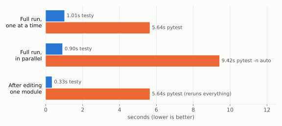

# testy

> [!WARNING]
> testy is a purely experimental project, built to explore a different set of tradeoffs for a Python test runner. It isn't production-ready, isn't published to PyPI, and its behaviour and options may change at any time.

A small, fast Python test runner with a different set of tradeoffs from pytest:

- **Fast.** Test files are found by parsing them, not importing them, so there is no slow collection step.
- **Skips unchanged tests.** Like `go test`, results are cached and a test file only reruns when something it imports has changed.
- **Simple.** No plugins, no `conftest.py`, no fixture injection. Tests are plain functions, and fixtures are plain Python you import.
- **Parallel by default.** On free-threaded Python (3.14t), test files run on real parallel threads.

<a href="https://asciinema.org/a/YEIEfpFVOER3UqUd"></a>

## Installation

testy isn't on PyPI. Install it from GitHub as a development dependency of the project you want to test, so it runs in that project's environment:

```bash
uv add --dev git+https://github.com/Jackevansevo/testy
```

Or with pip:

```bash
pip install git+https://github.com/Jackevansevo/testy
```

For parallel runs, use a free-threaded Python, for example by putting `3.14t` in the project's `.python-version` (`uv python install 3.14t`).

## Writing tests

Tests are top-level functions named `test*` that use plain `assert`. `async def` tests are supported.

There is no fixture system. A fixture is a context manager or function in a module your tests import, so its dependencies show up in the import graph like any other code:

```python
# tests/fixtures/todos.py
import contextlib

from calc.todos import create_app

_app = create_app({"TESTING": True})  # built once, when this module is first imported


@contextlib.contextmanager
def app():
    with _app.app_context():
        yield _app


@contextlib.contextmanager
def client():
    with app() as a:
        yield a.test_client()
```

```python
# tests/test_todos.py
from tests.fixtures.todos import client


def test_create_requires_title():
    with client() as c:
        assert c.post("/todos", json={}).status_code == 400
```

| pytest | testy |
|---|---|
| `scope="function"` fixture | `with fixture():` inside the test |
| `scope="session"` fixture | A module-level value in a fixtures module (Python's import lock builds it once) |
| `conftest.py` | `from tests.fixtures.x import y` |

Split fixtures into modules by topic (`tests/fixtures/numbers.py`, `tests/fixtures/todos.py`). testy tracks dependencies per file, so editing a fixture module reruns only the tests that import it.

### Rules that follow from the design

- **Isolation is your job.** Files run in parallel in one process and share module state, so tests must not modify shared objects or assume a shared database is empty.
- **Test output is discarded.** `print` output never appears. `breakpoint()` and `input()` fail immediately instead of hanging, unless you pass `--pdb`.
- **The cache only sees static imports.** See [Cache accuracy](#cache-accuracy).

## Benchmark

<picture>
  <source media="(prefers-color-scheme: dark)" srcset="bench/chart-dark.svg">
  
</picture>

20,000 trivial tests in 2,000 files, on Apple silicon with Python 3.14t. Most of pytest's time here is its own overhead, not the tests: collection, plus per-test capture, reports and plugin hooks.

That makes this close to a best case for testy. When tests do real work the gap shrinks: on CPU-heavy tests, full runs were only 3–10% faster.

Reproduce it with `uv run bench/bench.py --modules 5000 --tests 2000`, and redraw the chart with `uv run --with matplotlib bench/chart.py`.

## Requirements

Python 3.14 or later. Free-threaded Python (`uv python install 3.14t`) is needed for parallel speedups; on a regular build tests still run correctly, one at a time, and testy prints a warning.

## How it works

1. **Discover:** walk the given paths for `test_*.py` and read each file's top-level `test*` functions with `ast`, without importing anything.
2. **Graph:** run `ruff analyze graph` to find which files each file imports, adding the parent `__init__.py` files that importing a module runs.
3. **Hash:** give every file a key built from its own contents plus the keys of everything it imports. Import cycles are grouped and hashed together. The key also covers `uv.lock`, the Python version and testy's version.
4. **Skip:** a file whose key matches its last passing run is reported as `(cached)` and not run.
5. **Run:** the remaining files run in parallel, one file per thread. Each file's tests run in order on that thread.

Results are stored in `.testy/cache.json`.

## Cache accuracy

A test file is skipped when its cache key matches its last passing run. The key covers only:

- the contents of the test file and of every project file it imports, directly or indirectly, as reported by `ruff analyze graph` (plus the `__init__.py` files that importing them runs);
- `uv.lock`, if there is one;
- the Python version and testy's version.

Anything else that changes a test's outcome is invisible to the cache, and a stale pass will be reported as `(cached)`:

- **Dynamic imports:** `importlib.import_module`, `__import__`, plugins loaded by entry point, and other imports ruff can't resolve statically.
- **Files a test reads:** anything opened with `open()` or similar, such as JSON fixtures, templates, SQL files and `.env` files.
- **The environment:** environment variables, the clock, randomness, the network, and external services such as databases.
- **Code outside the project:** other repositories, path or editable dependencies, and installed packages when there's no `uv.lock`.
- **Other tests:** state that one test leaves behind for another in the same process.

Run with `--force` after changing any of these, and use `--force` in CI so every test runs there.
